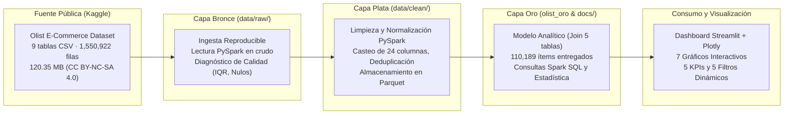

# 📦 Proyecto Integrador Big Data 2026-2 · Análisis de Olist E-Commerce en Python y PySpark

**Universidad Santo Tomás · Seccional Tunja**  
**Facultad de Ingeniería de Sistemas · Curso: Big Data (2026-2)**  
**Docente:** Ing. Martha Susana Contreras Ortiz  

### 👥 Integrantes del Equipo
* **Sebastián Felipe Vargas Quintero**
* **Néstor Camilo Peña Guarín**
* **Luis Carlos Taborda Flórez**

---

## 1. Contexto y Propósito del Proyecto (T1)

El comercio electrónico en América Latina enfrenta uno de sus mayores retos operativos en la logística de última milla y la asimetría de infraestructura entre regiones centrales y periféricas. Este proyecto analiza el conjunto de datos público **Brazilian E-Commerce Public Dataset by Olist**, que consolida la operación real de más de **99,441 pedidos** y **1,550,922 registros** totales distribuidos en 9 tablas relacionales entre 2016 y 2018 en Brasil.

### Preguntas de Análisis Concretas y Medibles
1. **Desempeño Logístico Regional:** ¿Cuánto tarda la entrega de pedidos por Estado (`UF`) y Macro-Región en Brasil, y en qué zonas se concentran las mayores tasas de incumplimiento (`entrega_tardia`) y sobrecostos de flete?
2. **Factores Asociados a las Malas Reseñas:** ¿En qué medida el tiempo total de entrega (`dias_entrega`), el retraso frente a la fecha prometida (`dias_retraso`), el costo de flete (`freight_value`) y el precio del producto (`price`) impactan la calificación del cliente (`review_score` de 1 a 5 estrellas)?
3. **Vulnerabilidad por Categoría de Producto:** ¿Cuáles son las categorías de productos (con volumen $\ge 200$ ítems) que registran peor calificación promedio y mayor incidencia de retrasos logísticos?
4. **Dinámica Temporal y Estructura de Pagos:** ¿Cómo evolucionaron mensualmente los tiempos de entrega y la satisfacción del cliente frente a picos estacionales (como *Black Friday*), y cómo se distribuye el valor transaccional según el método de pago y número de cuotas?

---

## 2. Temáticas del Syllabus Aplicadas

| Tipo | Temática del Syllabus | Implementación en el Proyecto |
| :--- | :--- | :--- |
| **Obligatoria 1** | **Procesamiento con Apache Spark, PySpark y Spark SQL (Unidad 3)** | Lectura distribuida de las 9 tablas crudas, transformación de tipos, deduplicación por ventana (`Window`), construcción de la Capa Oro mediante `JOIN` de 5 tablas (`110,189` ítems entregados válidos), filtros (`filter`), agregaciones (`groupBy`) y consultas analíticas en **Spark SQL** verificadas con `count()` y `show(n)`. |
| **Obligatoria 2** | **Python para análisis y representación de datos (Unidad 5)** | Limpieza y transformación documentadas con tabla comparativa antes/después, estadística descriptiva completa (media, desviación estándar, cuartiles $P_{25}, P_{50}, P_{75}, P_{95}$, rango intercuartílico IQR), matriz de correlación de Pearson y Spearman con **Pandas/NumPy**, visualizaciones con **Matplotlib/Seaborn** y dashboard interactivo en **Streamlit con 7 gráficos de Plotly**. |
| **Electiva B** | **Arquitectura y gobierno de datos: Lakehouse Bronce / Plata / Oro (Unidades 1 y 4)** | Arquitectura Medallion estructurada físicamente en el repositorio: **Capa Bronce (`data/raw/`)** con los 9 CSV originales, **Capa Plata (`data/clean/`)** con tablas depuradas y tipadas en formato **Parquet**, y **Capa Oro (`data/clean/olist_oro` y `docs/`)** con el modelo analítico unificado, diccionario de datos de 52 atributos, tratamiento de datos personales bajo la **Ley 1581 de 2012** y matriz de responsables por fuente. |

---

## 3. Arquitectura del Flujo de Datos (Medallion Architecture)



---

## 4. Estructura del Repositorio

```text
proyecto_bigdata/
├── app/
│   └── app.py                                # Aplicación web interactiva en Streamlit + Plotly (7 gráficos, 5 filtros, 5 KPIs)
├── data/
│   ├── raw/                                  # Capa Bronce: 9 archivos CSV originales de Olist (120.35 MB, 1,550,922 filas)
│   └── clean/                                # Capa Plata y Oro: Tablas limpias en formato Apache Parquet + tabla olist_oro
├── docs/                                     # Insumos analíticos exportados por PySpark para el informe y Streamlit Cloud
│   ├── diccionario_datos.csv                 # Diccionario completo de las 52 columnas (tipo, descripción, ejemplo, responsable)
│   ├── diagnostico_columnas.csv              # Diagnóstico automatizado de tipos, nulos, distintos y atípicos (IQR)
│   ├── diagnostico_duplicados.csv            # Conteo de duplicados exactos y por clave primaria
│   ├── metricas_antes_despues.csv            # Tabla comparativa de calidad antes vs. después de la limpieza
│   ├── olist_correlacion.csv                 # Matriz de correlación de Pearson sobre la Capa Oro (n = 110,189)
│   ├── olist_estadistica_descriptiva.csv     # Estadística descriptiva (media, DE, cuartiles, IQR)
│   ├── olist_resumen_categorias_sql.csv      # Salida Spark SQL: desempeño logístico y satisfacción por categoría
│   ├── olist_resumen_estados.csv             # Salida PySpark GroupBy: métricas por Estado (UF)
│   ├── olist_resumen_pagos.csv               # Resumen financiero por método de pago y cuotas
│   ├── olist_resumen_reviews_sql.csv         # Salida Spark SQL: cruce de calificación vs. cumplimiento logístico
│   ├── olist_serie_mensual.csv               # Serie temporal mensual (2017-2018) de entregas, retrasos y reseñas
│   └── volumen.csv                           # Resumen de filas, columnas y peso en MB por tabla
├── notebooks/
│   └── ProyectoIntegradorBigDataV2.ipynb     # Notebook principal ejecutado de principio a fin (Ingesta, PySpark, SQL, EDA)
├── .gitignore                                # Exclusión de entorno virtual (.venv) y archivos temporales (.crc)
├── requirements.txt                          # Dependencias para despliegue en Streamlit Community Cloud y ejecución local
└── README.md                                 # Documentación general e instrucciones de reproducción
```

---

## 5. Instrucciones para Ejecutar el Proyecto Localmente y en la Web

### Opción A: Ejecución Local del Dashboard de Streamlit
1. Clonar este repositorio y ubicarse en la carpeta raíz:
   ```bash
   git clone <URL_DEL_REPOSITORIO_GITHUB>
   cd proyecto_bigdata
   ```
2. Crear un entorno virtual e instalar las dependencias:
   ```bash
   python -m venv .venv
   # En Windows:
   .venv\Scripts\activate
   # En Linux/Mac:
   source .venv/bin/activate

   pip install -r requirements.txt
   ```
3. Ejecutar la aplicación de Streamlit:
   ```bash
   streamlit run app/app.py
   ```
4. Abrir en el navegador la dirección local `http://localhost:8501`.

### Opción B: Despliegue Directo en Streamlit Community Cloud (Página Web)
El repositorio incluye los datasets en `data/` y las tablas analíticas precalculadas por PySpark en `docs/`, por lo que la aplicación web funciona de manera autónoma en la nube:
1. Subir este repositorio a **GitHub**.
2. Ingresar a [share.streamlit.io](https://share.streamlit.io/) e iniciar sesión con GitHub.
3. Hacer clic en **"Create app"** y seleccionar:
   * **Repository:** `<tu-usuario>/<tu-repositorio>`
   * **Branch:** `main`
   * **Main file path:** `app/app.py`
4. Hacer clic en **"Deploy!"**.

### Opción C: Reproducción del Pipeline Completo en PySpark (Notebook)
Para volver a ejecutar el procesamiento distribuido en Google Colab o localmente en Jupyter:
```bash
pip install pyspark kagglehub
```
Abrir `notebooks/ProyectoIntegradorBigDataV2.ipynb` y ejecutar todas las celdas en orden. El notebook detecta automáticamente si se ejecuta en **Google Colab** o en **entorno local**, descarga los archivos si no existen en `data/raw/`, ejecuta las transformaciones con PySpark y actualiza los archivos Parquet en `data/clean/` y los CSV en `docs/`.

---

## 6. Licencia y Tratamiento de Datos Personales (Ley 1581 de 2012)
* **Fuente:** [Brazilian E-Commerce Public Dataset by Olist (Kaggle)](https://www.kaggle.com/datasets/olistbr/brazilian-ecommerce) · Fecha de descarga: `2026-11-19`.
* **Licencia:** Creative Commons Attribution-NonCommercial-ShareAlike 4.0 International (**CC BY-NC-SA 4.0**).
* **Cumplimiento de la Ley 1581 de 2012 (Habeas Data):** El dataset no contiene nombres propios, documentos de identidad, direcciones exactas, teléfonos ni correos electrónicos. Los identificadores de clientes (`customer_id`, `customer_unique_id`) y vendedores (`seller_id`) se encuentran **seudonimizados mediante hashes criptográficos MD5 de 32 caracteres**, y la ubicación geográfica está truncada a los primeros 5 dígitos del código postal (`zip_code_prefix`) y agregada por centroide en la capa limpia, garantizando la imposibilidad de reidentificación individual.
